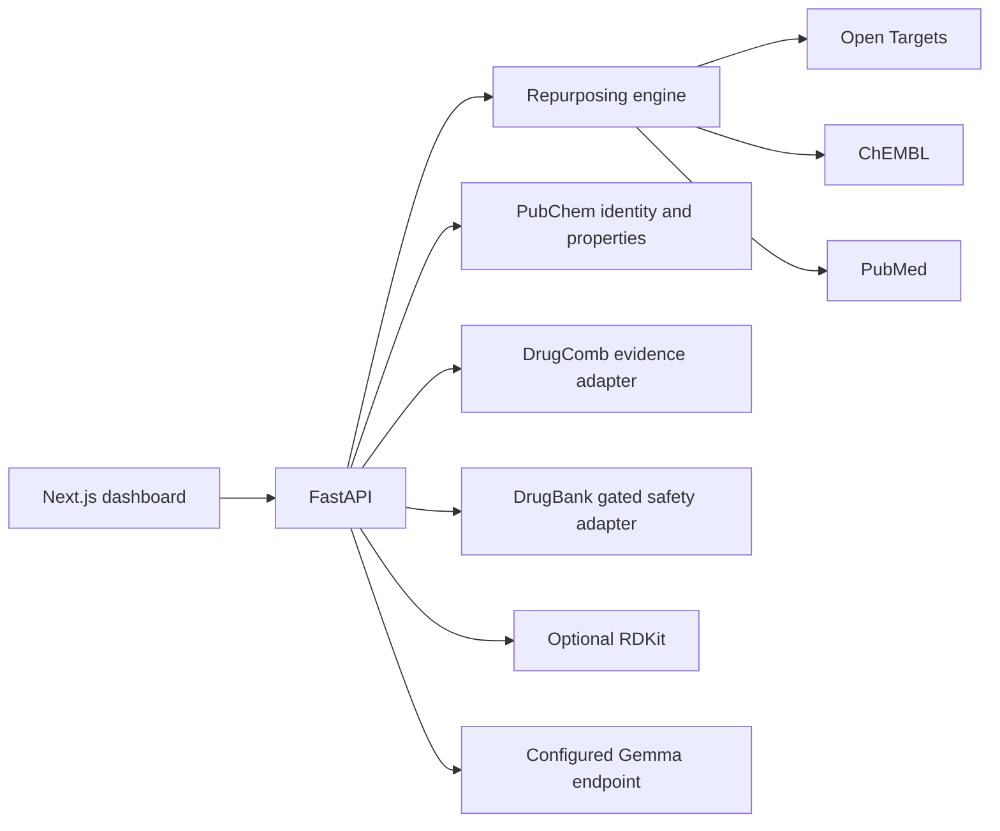

# DrugDiscover AI

Evidence-grounded drug repurposing and combination research MVP. This is a computational research interface, not a diagnostic, prescribing, or dosing tool.

## Quick start

Python 3.10+ and Node.js 22+ are supported. From the project root:

```powershell
python -m venv .venv
.\.venv\Scripts\Activate.ps1
pip install -r backend/requirements.txt
Copy-Item .env.example .env
python -m uvicorn backend.main:app --reload
```

In a second terminal:

```powershell
cd frontend
npm install
npm run dev
```

Open http://localhost:3000. API documentation is at http://localhost:8000/docs and health at http://localhost:8000/health. The frontend uses `NEXT_PUBLIC_API_URL` (default `http://localhost:8000`). The backend loads `.env` from the project root. The `Gemma` adapter expects an OpenAI-compatible `/chat/completions` endpoint; set `GEMMA_BASE_URL`, `GEMMA_MODEL`, and optional `GEMMA_API_KEY`.

Production frontend:

```powershell
cd frontend
npm install
npm run build
npm start
```

## Evidence providers

- **Open Targets** resolves disease names and associated target symbols through its GraphQL API. Ambiguous disease names are not silently selected.
- **ChEMBL** retrieves target-linked activity records and retains drug, target, assay, activity value, confidence, and source identifiers where supplied.
- **PubChem** resolves submitted drug names to CIDs and source-reported structure/property records. Multiple matches remain flagged as ambiguous; review salt form, stereochemistry, and formulation.
- **PubMed** supplies literature records for the disease query.
- **DrugComb** uses the public `/response/` resource only when `DRUGCOMB_DRUG_A_PARAM` and `DRUGCOMB_DRUG_B_PARAM` have been set to parameter names verified for the deployed API. This project does not guess the parameter schema. Returned synergy is source-reported only; no score is calculated.
- **DrugBank** remains unavailable unless authorized credentials and a verified account-specific API schema are supplied. The current adapter will not send a request based only on a key or guessed endpoint.
- **RDKit** is optional. Without it, SMILES validation and descriptors return explicit unavailable status and null properties.

External API integrations depend on network access, upstream availability, licensing, and rate limits. Unit and endpoint tests use mocked source responses so they do not fabricate live data.

## Evidence rules

Target associations are research hypotheses, not proof of efficacy. Separate computational, experimental, preclinical, and clinical evidence; do not infer a clinical outcome from a target link. Experimental combination records must retain metric, cell line, concentrations, units, ratios, study, and source identifiers. Ratios derived arithmetically from source concentrations are labelled as experimental arithmetic and are never dosage guidance. Missing interaction data stays `UNKNOWN` and workflow decisions stay `REVIEW`. No patient-specific treatment or dosing guidance is generated.

## Architecture



## Demonstration script

1. Enter a disease and inspect Open Targets, ChEMBL, and PubMed source statuses and target-linked candidate evidence.
2. Choose a returned candidate and use it as Drug A; enter a second compound. Resolve both through PubChem and inspect returned CIDs/properties, including any ambiguity warning.
3. Query DrugComb only after configuring parameter names verified for the API deployment. Review source-reported metric, cell line, study, and experimental concentrations. Otherwise, an explicit unavailable result is expected.
4. Inspect ratio comparisons; only source concentrations are shown and no clinical dose is inferred.
5. Review safety status. Without authorized DrugBank coverage the result remains `UNKNOWN`/`REVIEW`.
6. Request a Gemma explanation after configuring a compatible provider; the response schema preserves uncertainty, missing evidence, and only supplied citation identifiers.

## Tests and verification status

```powershell
python -m compileall -q backend
python -m unittest discover -s backend/tests -v
```

The backend suite currently passes 70 tests, including provider adapter tests, API endpoint smoke tests, and a mocked disease-to-combination workflow. The disease-search route test mocks Open Targets directly. These mocked tests verify parsing and failure handling, not live upstream availability.

On 2026-10-31, live Open Targets, ChEMBL, PubChem, and PubMed calls all failed with connection errors in this environment. DrugComb remains disabled unless its deployed query contract is verified and configured; DrugBank and Gemma require credentials/configuration. See `IMPLEMENTATION_REPORT.md` and `PROJECT_STATUS.md` for the precise verification state.

`frontend/package.json` declares Next.js 15.5.28. The cached installation is 15.5.5; a production build passed with 15.5.5 only. `npm install` could not reach `registry.npmjs.org` (`EACCES`), and the declared-version build is not verified. After registry access is restored, run `npm install`, confirm `node -p "require('./node_modules/next/package.json').version"` prints 15.5.28, then run `npm run build`.


## Current verified state (2026-10-31)

Backend compilation and **70 automated tests** pass; these tests use mocked provider responses. `npx tsc --noEmit` and `npm run build` pass on cached Next.js **15.5.5**, while the manifest declares **15.5.28**. Installing 15.5.28 and generating a lockfile are blocked by registry `EACCES`. Live Open Targets, ChEMBL, PubChem and PubMed requests failed due connection restrictions. DrugComb is disabled pending a verified deployed query schema; DrugBank requires authorized account access and its documentation; Gemma requires endpoint/model configuration; RDKit is unavailable in the current backend. See `PROJECT_STATUS.md` and `IMPLEMENTATION_REPORT.md` for details and blockers.
